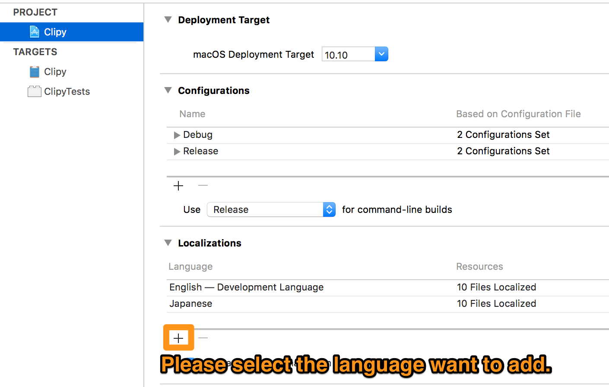

# Contributing to SnipClip

:tada: Thank you for contributing to SnipClip :tada:

## Localization

### Add New Language

After adding the language, please make changes to the various `.strings` files as follows.

### Modify an Existing Language
The files to be localized are as follows.
- Localizable.strings ( `SnipClip/Resources/#{language_name}.lproj/Localizable.strings` )
- Preferences ( `SnipClip/Sources/Preferences/#{language_name}.lproj/*.strings` )
- PreferencesPanels ( `SnipClip/Sources/Preferences/Panels/#{language_name}.lproj/*.strings` )
- SnippetsEditor ( `SnipClip/Sources/Snippets/#{language_name}.lproj/*.strings` )

**English localization only, please edit `.xib` files directly**
